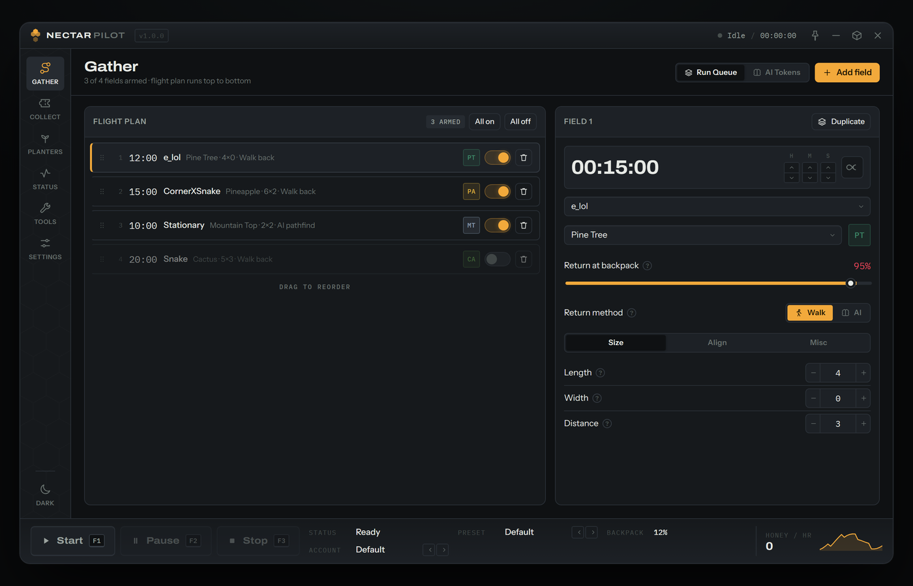
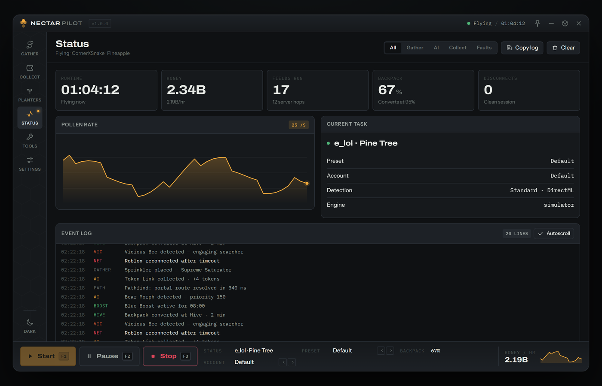
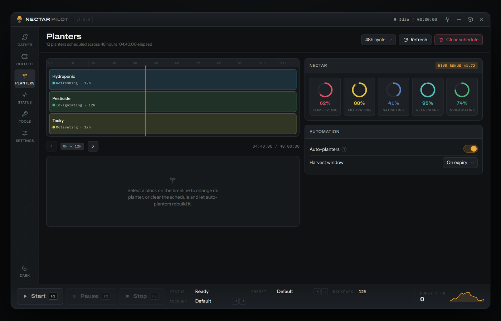
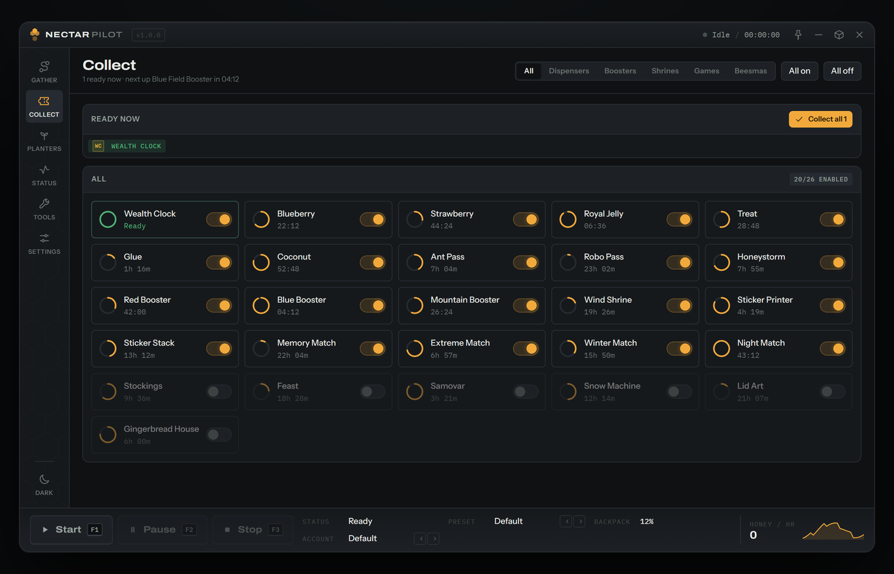

## Nectar Pilot

Nectar Pilot is a Bee Swarm Simulator macro for **Windows** and **macOS**, built around one idea: it should feel
like a flight deck, not a control panel. You arm a flight plan once, and the instruments tell you what the machine
is actually doing.

* **AI Stinger Hop** — public server hop with advanced AI detection and searcher support.
* **AI Pathfinding** — your character moves task-to-task without resetting, taking the most optimised route every
  time. Portals and cannons are fully supported.
* **Gather** — an ordered flight plan of fields that runs top to bottom, with per-field patterns, sizing, alignment
  and return rules.
* **Collect** — every dispenser in the game on one board, with live cooldown rings and one-tap collect-all.
* **Planters** — the full harvest schedule on a real timeline, with nectar gauges for all five types.

<p align="center">
  
  
  
  
</p>

## Interface

The interface lives in [`ui/`](ui) and runs standalone — open `ui/index.html` in any modern browser, no build
step and no network access required. Fonts are inlined as data URIs and there are no external dependencies.

```
ui/index.html    chassis: title strip, instrument rail, work surface, command dock
ui/styles.css    design system — tokens, both themes, controls, screens
ui/app.js        state, persistence, run loop, screens, hotkeys
ui/fonts.css     Archivo, Instrument Sans and IBM Plex Mono, inlined
```

Every control is live: the flight plan reorders by drag, timers count down, dispenser cooldowns tick, the event log
streams, and hotkeys drive the transport. State persists to `localStorage`.

`python build.py` bundles the whole interface into a single self-contained `dist/nectar-pilot.html`.

### Wiring up an engine

The UI talks to the outside world through one object, so a native host can drive the same interface:

```js
window.NectarPilotBackend = {
  name: 'native',
  start() { /* … */ return true; },
  pause() { /* … */ return true; },
  stop()  { /* … */ return true; },
  sample(active) {
    return { honeyPerSec: 0, pollenRate: 0, backpackDelta: 0 };
  },
};
```

Define it before `app.js` loads, or call `NectarPilot.setBackend({ … })` afterwards. Without one, the interface runs
against a built-in simulator so every screen stays explorable.

### Hotkeys

| Action | Default |
| --- | --- |
| Start run | <kbd>F1</kbd> |
| Pause run | <kbd>F2</kbd> |
| Stop run | <kbd>F3</kbd> |
| Reload preset | <kbd>F4</kbd> |
| Emergency stop | <kbd>F8</kbd> |

All five are rebindable in **Settings › Hotkeys**.

## Credits

Nectar Pilot's interface, design system and build are by **Horalix**.

## Download

Check the [Releases](https://github.com/nosyliam/revolution-macro/releases) page for the latest build.
